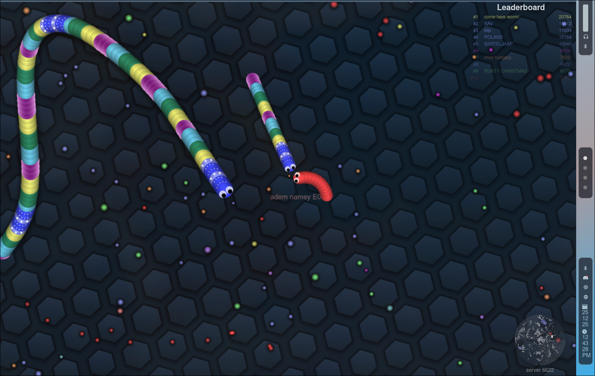
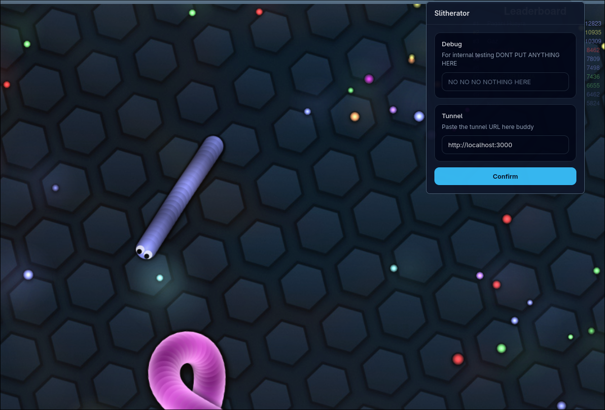

    <h1>Slitherator</h1>
    

## About 

Slitherator is a webextension designed to transmit and recieve position data to and from other players in Slither.io. 

It was borne out of a need for greater efficiency of communication due to the increase in strategic complexity - put simply, we needed to know where our other teammates were at all times, with zero delay.

Relies on the Slitherator Server - no server - no service!

## Examples

| 2 Slithers slithering  | The UI!!!!!!!!!!!!!!!!!!!   | 
| ------ | ----- | 
|  |  |

## How to install
Either download the corresponding install for your browser from the installs, or do it yourself